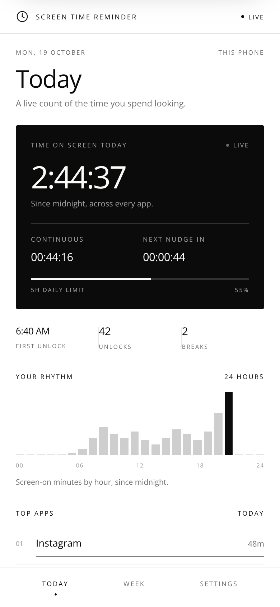
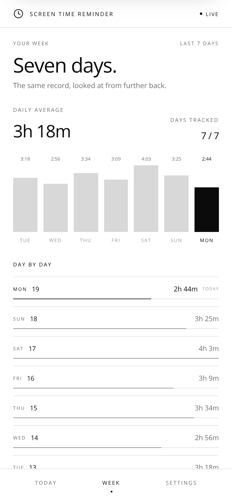
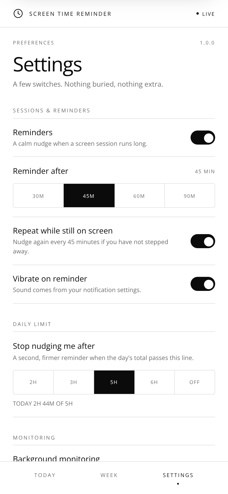
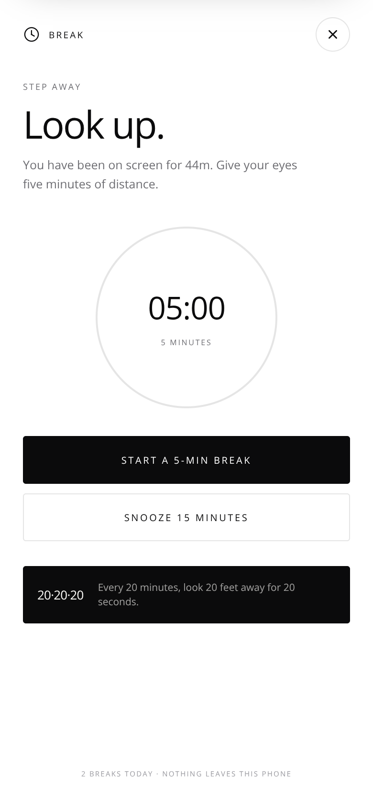

<div align="center">

# Screen Time Reminder

**A live count of the time you spend looking — and one calm nudge to step away.**

Free · No ads · No tracking · No account

<sub>Made by [Just Simple Apps](https://www.justsimpleapps.online/) · Android · Kotlin + Jetpack Compose</sub>

</div>

---

   

## What it does

- **Live screen time.** Reads the phone's own usage record — the same numbers Android's Digital Wellbeing shows — and updates every second while the app is open.
- **Break reminders.** After a continuous session of 30, 45, 60 or 90 minutes, one notification asks you to look up. Snooze it for 15 minutes or start a five-minute break.
- **Continuous, not cumulative.** Two minutes away from the phone resets the session. The app nudges on *unbroken* screen time, not just total minutes.
- **Daily limit.** A second, firmer reminder when the day's total passes 2h / 3h / 5h / 6h.
- **Seven-day history.** Daily totals, daily average, lightest day, longest session, breaks taken.
- **Top apps and hourly rhythm.** Where today went, app by app and hour by hour.
- **A real break timer.** A five-minute dial, 20-20-20 guidance, and a break count.
- **Pure Light and Deep Dark.** Paper, ink and one hairline — no colour competing with the content.

## Privacy

There is no account, no analytics SDK and no advertising ID. Screen-time numbers, settings and daily totals are kept in `SharedPreferences` on the phone. No network permission is requested — the app cannot send anything anywhere.

It reads only *which app was in front and for how long*. Never content, messages or files.

## How it works

| Piece | Role |
| --- | --- |
| `data/UsageRepository.kt` | Queries `UsageStatsManager` for today's foreground time, hourly buckets, unlocks and the app in front right now. 15–20 s cache, with a screen-on live delta between polls. |
| `data/SessionEngine.kt` | Decides when a continuous session earns a nudge. Two minutes away resets it. Shared by the UI and the background monitor so both always agree. |
| `data/ScreenTimeStore.kt` | Settings, today's counters and 30 days of daily history. Compose state, so every screen follows along. |
| `service/ScreenTimeService.kt` | A low-priority foreground service that checks every 20 seconds and posts reminders in the background. |
| `notifications/Notifiers.kt` | Break, daily-limit, test and monitor notifications, with a snooze action. |
| `ui/` | Compose screens: onboarding, today, week, settings and the break overlay. |

## Install

Download the APK from the **[v1 release](https://github.com/owaiskhan-ash/ScreenTime-Reminder/releases/tag/v1)** or the rolling **[apk-latest release](https://github.com/owaiskhan-ash/ScreenTime-Reminder/releases/tag/apk-latest)** and open it on the phone.

Direct download (v1): `https://github.com/owaiskhan-ash/ScreenTime-Reminder/releases/download/v1/ScreenTimeReminder.apk`
Direct download (latest): `https://github.com/owaiskhan-ash/ScreenTime-Reminder/releases/download/apk-latest/ScreenTimeReminder.apk`

On first run, allow **Usage access** (Android opens the settings page) and **notifications**. Android requires these for any app to read screen time or send reminders.

### If access is blocked — “personal and financial data at risk” / greyed-out toggle

On Android 13+ (Samsung, Pixel, OnePlus, Xiaomi), apps you install from a file (side-load, not Play Store) are put under **Restricted Settings**. The system then blocks the Usage Access toggle with a scary generic warning — even though this app has **no internet permission** and never sends data anywhere; it only reads *which app was in front and for how long*.

**Fix (15 seconds):**

1. Open **Settings → Apps → Screen Time Reminder** (or long-press the app icon → App info)
2. Tap the **⋮ three-dot menu** at the top-right → **Allow restricted settings** → confirm
3. Go back and tap **Allow screen time access** again (or in the app: **Settings → Screen time access → OPEN ACCESS SETTINGS**)
4. Find **Screen Time Reminder** in the list and toggle it **ON** → Allow

> Samsung: Apps → ⋮ → Special access → Usage access. Pixel: same. Xiaomi/Realme: Settings → Apps → ⋮ → Allow restricted settings, then enable usage access. If you still see a grey toggle, repeat step 2 — restricted settings must be allowed *before* the toggle works.

You only do this once. The app now shows **LIMITED MODE → LIVE** and your real Today / TOP APPS / RHYTHM fill in.

## Build

```bash
./gradlew assembleDebug
```

The APK lands in `app/build/outputs/apk/debug/`. Requires JDK 17 and the Android SDK (compileSdk 35).

GitHub Actions builds it on every push to `main` (or on demand via **Actions → Build APK → Run workflow**) and attaches the freshly built APK to the rolling [`apk-latest`](https://github.com/owaiskhan-ash/ScreenTime-Reminder/releases/tag/apk-latest) release.

> Build verified in CI: `./gradlew assembleDebug` completes and the 8.9 MB APK is published to `apk-latest`.

## Design preview

`preview/` holds a dependency-free browser prototype of the same interface and the same break logic, used for design review before a device build. Open `preview/index.html`, or serve it:

```bash
cd preview && python3 -m http.server 8000
```

The prototype simulates screen time and app names. Settings and theme are saved in `localStorage`.
